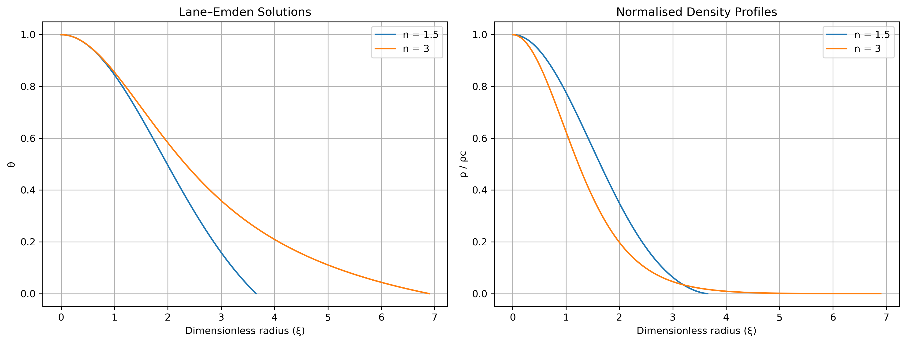
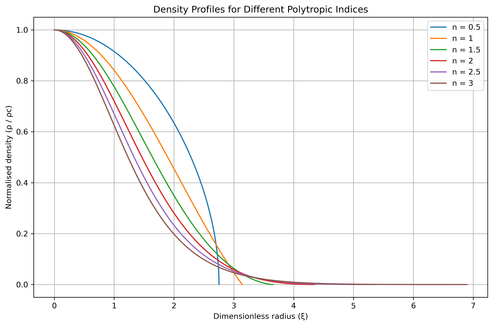
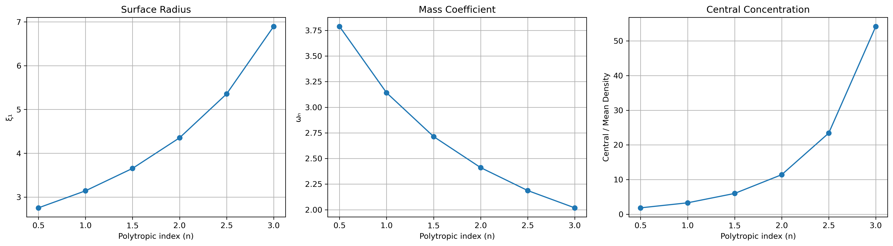
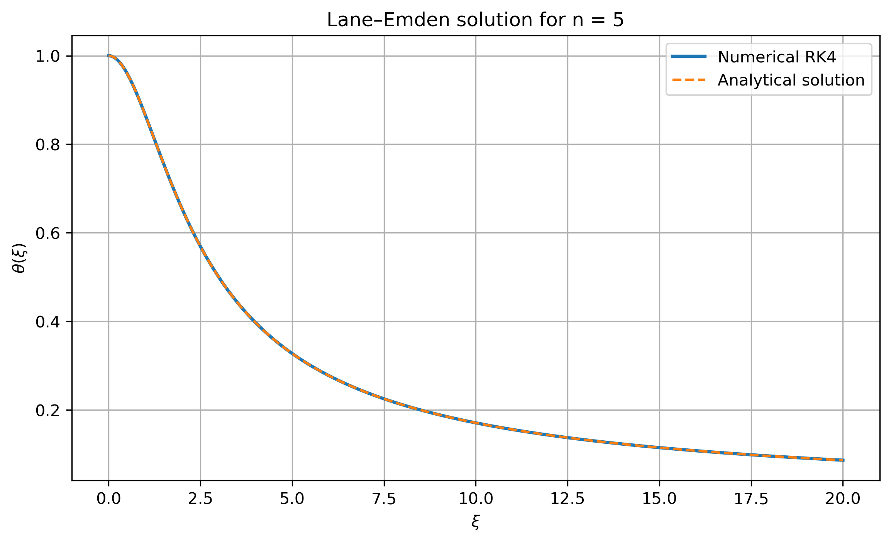

# Numerical Modelling of Stellar Structure Using the Lane–Emden Equation

## Project Overview

This project investigates the internal density distributions of polytropic stellar models by numerically solving the Lane–Emden equation using the fourth-order Runge–Kutta (RK4) method.

The Lane–Emden equation describes the structure of a spherically symmetric, self-gravitating polytropic gas sphere under hydrostatic equilibrium. By varying the polytropic index \(n\), this project examines how different pressure–density relationships influence stellar density distributions and central concentration.

The numerical solutions are validated against known analytical solutions for \(n=1\) and \(n=5\). The project also explores the critical behaviour of the \(n=5\) polytrope, which has no finite stellar surface.

An interactive Streamlit application allows users to explore the effects of varying the polytropic index and numerical step size on the resulting stellar models.

## Research Question

**How does the assumed pressure–density relationship influence the internal density distribution and central concentration of a star in hydrostatic equilibrium?**

## Interactive Application

Explore the numerical solutions using the interactive Streamlit application.

**Live App:** [Open Lane–Emden Explorer](https://k4gwmktwzc6r4uh3elcvrv.streamlit.app/)

## Results and Visualisations

### Lane–Emden Solutions

### Density Distribution

### Parameter Exploration

### Analytical Validation: n = 5

## Key Findings

- Increasing the polytropic index produces increasingly centrally concentrated density distributions.
- Numerical solutions for \(n=1\) agree with the analytical solution.
- The \(n=5\) solution has no finite surface radius.
- The numerical \(n=5\) solution agrees with its analytical counterpart.
- Numerical accuracy improves with decreasing integration step size.

## Limitations

- Assumes spherical symmetry and hydrostatic equilibrium.
- Uses a polytropic equation of state.
- Does not model rotation, magnetic fields, or energy transport.
- Results are dimensionless unless physical scaling parameters are specified.
- Polytropic models are idealised representations of stellar structure.
